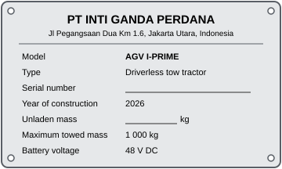
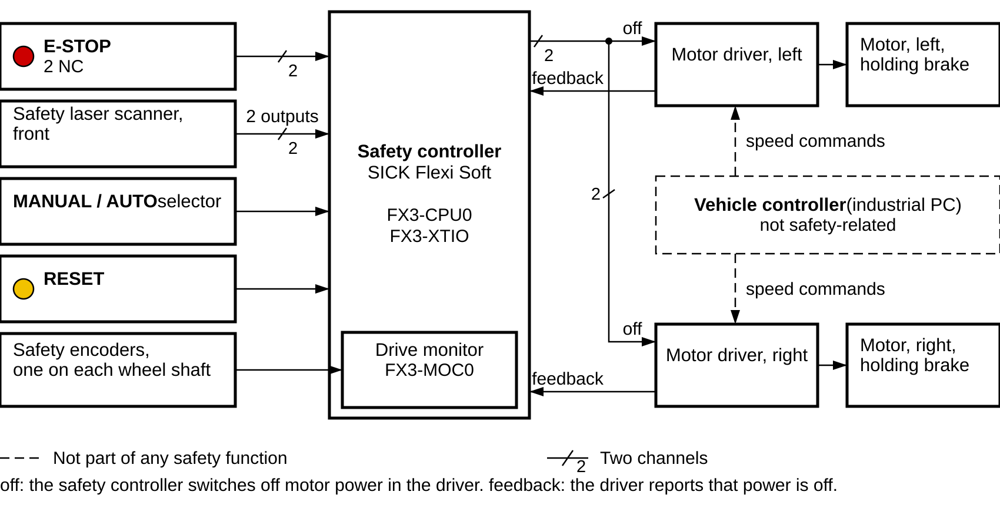
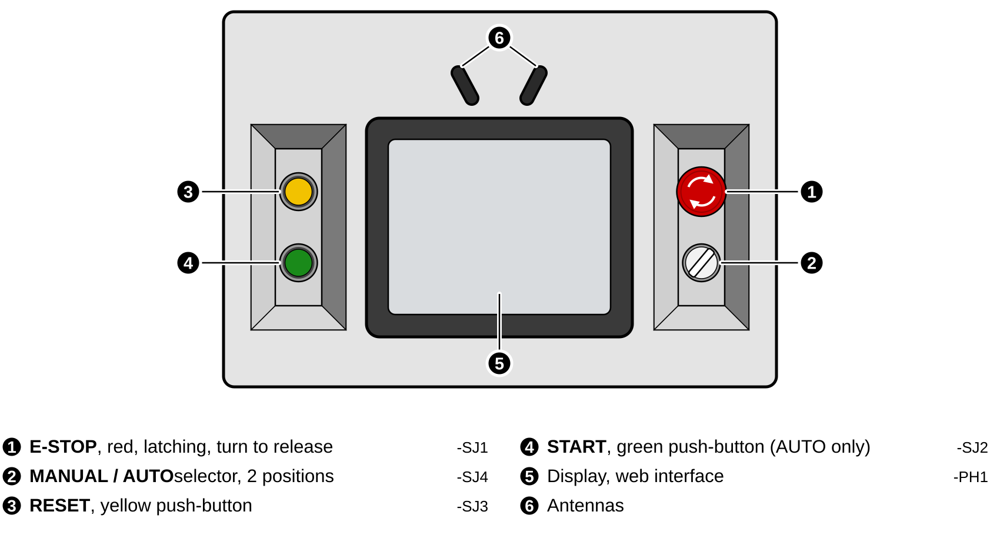
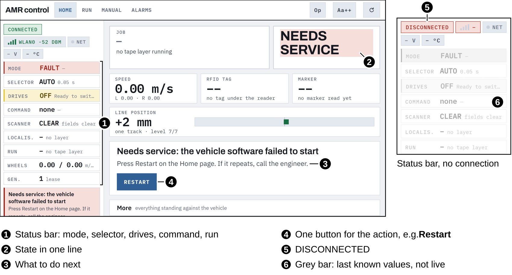
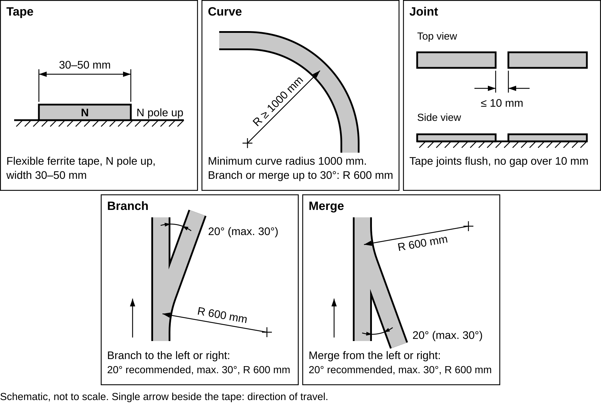

# AGV I-PRIME Driverless Towing Vehicle — Operation Manual

> **DRAFT — Revision A, for preliminary review. Not for release.**

Yellow highlights mark values still to be filled in or confirmed; `[IMG-…]` marks a picture still to be added. Grey boxes marked **[REVIEW]** are open points for the preliminary review.

---

## Document information

| Field           | Value                                                                     |
| --------------- | ------------------------------------------------------------------------- |
| Legal owner     | PT INTI GANDA PERDANA                                                     |
| Document number | IGP-IPR-OM-001                                                            |
| Title           | AGV I-PRIME Driverless Towing Vehicle — Operation Manual                 |
| Document type   | Instructions for use                                                      |
| Revision        | A (draft)                                                                 |
| Date of issue   | 2026-11-01                                                                |
| Language        | English (en)                                                              |
| Created by      | JOY M.                                                                    |
| Checked by      | JOKI I.                                                                   |
| Approved by     | ROBERTA A.                                                                |
| Applies to      | Model AGV I-PRIME, serial numbers GVI-1T0, vehicle software V1.0.0-V2.0.0 |

### Revision history

| Rev | Date       | Change                             | Author |
| --- | ---------- | ---------------------------------- | ------ |
| A   | 2026-11-01 | First draft for preliminary review | JOY M. |

### Contents

- About this manual
- Standards used as reference
- Precautions for safe use
- Precautions for correct use
- 1. Identification
- 2. Intended use and limits
- 3. Safety
- 4. Vehicle description
- 5. Towing
- 6. Operating zone and site preparation
- 7. Storage and installation
- 8. Commissioning
- 9. Operating modes
- 10. Operation
- 11. Emergency situations
- 12. Battery charging
- 13. Safety-function checks
- 14. Fault finding and alarms
- 15. Maintenance
- 16. Technical data
- 17. Decommissioning and disposal
- Annexes A–E

---

## About this manual

### Who this manual is for

This manual is for the operators, the maintenance personnel and the commissioning engineer (chapter 3.2 lists who may do what).

Persons who have not been instructed must not operate the vehicle. Persons who only work in the operating zone (pedestrians, forklift drivers) must be told about the vehicle, its warning signals and the hazard zones (chapter 3.6).

### Keep this manual

Read this manual before first use. Keep it with the vehicle or at the workplace, where operators can reach it during work, for the whole life of the vehicle. Pass it on with the vehicle. Request manufacturer for latest version.

### Safety messages

Safety messages start with a signal word: **DANGER** (will cause death or serious injury), **WARNING** (can cause death or serious injury), **CAUTION** (can cause minor injury), **NOTICE** (damage to property only).

### Other conventions

- Controls on the vehicle are written in capitals (**START**), web pages in bold (**Home**), messages shown by the vehicle in fixed-width font (`ESTOP`).
- Units are SI: speeds in m/s, distances in mm.

### Related documents

| Document                                        | Number                 | Content                              |
| ----------------------------------------------- | ---------------------- | ------------------------------------ |
| Circuit diagrams                                | IGP-IPR-CD-001         | Electrical equipment, safety circuit |
| Component list                                  | IGP-IPR-CL-001         | All electrical components            |
| SICK nanoScan3 operating instructions           | SICK                   | Safety laser scanner                 |
| SICK Flexi Soft hardware operating instructions | SICK 8012478           | Safety controller                    |
| SICK DFS60S Pro operating instructions          | SICK 8016866           | Safety encoders on the wheel shafts  |
| Oriental Motor BLV Series R operating manuals   | Oriental Motor HP-5142 | Motor drivers                        |
| SICK MLS operating instructions                 | SICK                   | Magnetic line sensor                 |

---

## Standards used as reference

> **[REVIEW]** The vehicle is intended for the Indonesian market. The standards below were used as a design reference only; no conformity assessment has been done.

- ISO 3691-4:2023: driverless industrial trucks
- ISO 12100:2010: risk assessment
- ISO 13849-1:2023: safety-related parts of control systems
- EN 1175:2025: electrical requirements for industrial trucks
- ISO 7010:2019: safety signs

---

## Precautions for safe use

These rules apply at all times. Each chapter adds the rules for its task.

- Do not ride on the vehicle or on the trolleys.
- Do not step in front of a moving vehicle or train, and do not throw objects in front of it. The safety scanner stops the vehicle, but not instantly (chapter 16.3).
- Do not stand between the vehicle and a trolley, or between trolleys, while the vehicle is in **AUTO**.
- Couple and uncouple trolleys only when the vehicle is stopped at a stop point or in **MANUAL** with **MANUAL ARM** pressed in.
- Do not exceed the towing limits in chapter 2.2 and chapter 5.
- Use the vehicle only on the level floor and in the operating zone prepared as in chapter 6.
- Never cover, bridge, mute or change a protective device. Never change the configuration of the safety scanner or the safety controller. Only the commissioning engineer may change them, and only with re-verification (chapter 8.5).
- In **MANUAL**, the safety scanner does **not** stop the vehicle. Drive by hand only with the vehicle and its path in view, and only as fast as the situation allows.
- Keep the operating zone free of people who have not been instructed.
- Report every damage, unusual noise, unusual behaviour or failed check to the person responsible. Take the vehicle out of service if a protective device does not work.
- Use only the charger supplied with the vehicle. Charge only in the charging area (chapter 12).
- Before any work inside the vehicle, switch it off and lock it out (chapter 15.1).
- The web interface has no user authentication. Keep the vehicle and the tablet on a closed, trusted network.

---

## Precautions for correct use

These notes protect the vehicle and its performance. They are not safety rules.

- Keep the magnetic tape clean and undamaged. Worn, lifted or dirty tape causes stops (`MLS_FIELD_WEAK`, `TRACK_LOST`).
- Clean the scanner window regularly (chapter 15.3). Dirt causes unwanted stops.
- Avoid driving over steps, gaps, cables and loose objects; they shorten the life of wheels and gearboxes.
- After a software update, reload the web pages (**↻** button) so the browser does not use old pages.
- Do not switch off the battery main switch while the vehicle is driving. A sudden loss of power latches an alarm in the motor drivers that needs a power cycle (`UNCLEAN_SHUTDOWN`).
- Store the tablet used for the web interface where unauthorised persons cannot use it.

---

## 1. Identification

### 1.1 Manufacturer

PT INTI GANDA PERDANA, Jl Pegangsaan Dua Km 1.6, Jakarta Utara, Indonesia

Sales: sales@igp-astra.co.id · Service: iprime-service@igp-astra.co.id

### 1.2 Product

| Item                 | Value                                                                            |
| -------------------- | -------------------------------------------------------------------------------- |
| Product              | AGV I-PRIME driverless towing vehicle                                            |
| Model                | AGV I-PRIME                                                                      |
| Type                 | Driverless tow tractor, differential drive, guided by magnetic tape on the floor |
| Year of construction | 2026                                                                             |

This edition covers the towing vehicle with magnetic-tape guidance. Navigation features that decide *where* the vehicle stops or how fast it drives on a section (stop-point tags, route markers, map-based navigation) are described in the software documentation. They are not safety functions; the safety functions in chapter 3.3 work the same with or without them.

### 1.3 Nameplate

| Field                | Value                                                                     |
| -------------------- | ------------------------------------------------------------------------- |
| Manufacturer         | PT INTI GANDA PERDANA, Jl Pegangsaan Dua Km 1.6, Jakarta Utara, Indonesia |
| Model                | AGV I-PRIME                                                               |
| Type                 | Driverless tow tractor                                                    |
| Serial number        | Stamped on each vehicle                                                   |
| Year of construction | 2026                                                                      |
| Unladen mass         | 150 kg                                                                    |
| Maximum towed mass   | 1 000 kg                                                                  |
| Battery voltage      | 48 V DC                                                                   |

## 2. Intended use and limits

### 2.1 Intended use

The vehicle tows trolleys along a fixed tape route, marked by magnetic tape on the floor. It is for internal transport in industrial buildings, in areas where the people present have been instructed about the vehicle.

It runs:

- **automatically** (**AUTO**): it follows the tape, stops at programmed stop points and continues when the operator presses **START**;
- **by hand** (**MANUAL**): the operator drives it with the pendant or the web interface, for positioning, moving it to the charging area, and bringing it back onto the tape.

Trolleys are coupled and uncoupled by hand by the operator at stop points.

### 2.2 Operating limits

| Item                         | Limit                                                                                             |
| ---------------------------- | ------------------------------------------------------------------------------------------------- |
| Towed mass (trolleys + load) | max. 1 000 kg                                                                                     |
| Number of trolleys per train | 2                                                                                                 |
| Trolley requirements         | See chapter 5.2                                                                                   |
| Speed, automatic             | 0.50 m/s normal; 0.85 m/s only in sections of the tape route marked for it                        |
| Speed, manual                | max. 0.60 m/s straight; 0.39 rad/s turning on the spot                                            |
| Driving direction, automatic | Forward along the tape. Pivot turns at the end of the tape route only without trolleys            |
| Floor                        | Level, 0 % gradient. Dry, clean, firm; flatness ±5 mm over 2 m; steps max. 5 mm, gaps max. 10 mm |
| Ambient temperature          | +5 °C to +40 °C for short periods; +30 °C 24 h average                                         |
| Humidity                     | 10–90 % RH, non-condensing                                                                       |
| Altitude                     | max. 2 000 m                                                                                      |
| Environment                  | Indoors only. No rain, spray water, dust clouds, steam or smoke that can affect the scanner       |
| Lighting                     | No direct strong light (sunlight, spotlights) into the scanner                                    |

### 2.3 What not to do

The following is not allowed:

- riding on the vehicle or on trolleys; transporting persons;
- pushing trolleys in front of the vehicle; towing in reverse;
- towing more than 1 000 kg, more trolleys than allowed, or trolleys that do not meet chapter 5.2;
- pivot turns or U-turns with trolleys coupled;
- operation on ramps, slopes or loading docks; on wet, oily or icy floors; outdoors;
- operation in public areas, on public roads, in residential areas;
- operation in explosive atmospheres, corrosive atmospheres or with ionising radiation;
- transporting hazardous goods;
- operation with a protective device bridged, muted, covered, damaged or with a changed configuration;
- operation in **AUTO** away from the tape, or on a tape route not prepared as in chapter 6;
- driving in **MANUAL** without seeing the vehicle and its path;
- operation by persons who are not instructed;
- modifying the vehicle, its software or its parameters without the manufacturer's approval;
- using the vehicle as a tool to pull, push or lift anything other than approved trolleys.

---

## 3. Safety

### 3.1 General safety rules

The vehicle moves automatically and can start without anyone at the controls when the operator has pressed **START**. Everyone in the operating zone must know:

- a 2-second warning sound comes before every automatic start;
- the vehicle and its trolleys follow the floor tape;
- the vehicle stops for an obstacle directly in front of it, but **not** for a person beside the tape route or beside the trolleys;
- the **E-STOP** button stops the vehicle at once in every mode.

### 3.2 Personnel and qualifications

| Role                   | Allowed tasks                                                                                                                   | Required training                                                          |
| ---------------------- | ------------------------------------------------------------------------------------------------------------------------------- | -------------------------------------------------------------------------- |
| Operator               | Daily check, coupling and uncoupling, **START**/**RESET**, manual driving, charging, clearing operator-level alarms | Instruction with this manual and on the vehicle; record kept by the user   |
| Maintenance personnel  | Periodic checks (chapter 13), cleaning, inspection, replacement of parts listed in chapter 15.4                                 | Technical training; electrical work only by an electrically skilled person |
| Commissioning engineer | Site preparation, tape layout, commissioning, parameter changes, safety configuration, engineering pages                        | Manufacturer training                                                      |

### 3.3 Safety functions

The safety functions are hard-wired: the emergency stop, the front safety laser scanner and two safety encoders on the wheel shafts are connected to a safety controller, which cuts motor power through both motor drivers. The vehicle controller and its software are **not** part of any safety function. The last three rows of the table are software functions. The safety functions have not yet been validated (review notes at the end of the manual).

| Function                                                        | Device(s)                                                                                                         | Effect                                                                                                                                                                                                      | To continue                                                            |
| --------------------------------------------------------------- | ----------------------------------------------------------------------------------------------------------------- | ----------------------------------------------------------------------------------------------------------------------------------------------------------------------------------------------------------- | ---------------------------------------------------------------------- |
| Emergency stop                                                  | **E-STOP** push-button on the control panel → safety controller → both motor drivers                      | Motor power cut at once, holding brakes applied                                                                                                                                                             | Release **E-STOP**, press **RESET**, press **START** |
| Personnel detection, front                                      | Front safety laser scanner, protective field → safety controller → both motor drivers                           | Motor power cut at once                                                                                                                                                                                     | Automatic, 2 s after the field is clear                                |
| Mode selection (protective field active only in **AUTO**) | **MANUAL / AUTO** selector → safety controller                                                             | —                                                                                                                                                                                                          | —                                                                     |
| Motor power-off check                                           | Feedback from both motor drivers → safety controller                                                             | Prevents a restart if a driver did not switch off                                                                                                                                                           | —                                                                     |
| Speed limit in **AUTO**                                   | Safety encoders on both wheel shafts → safety controller                                                         | Motor power cut if the speed exceeds 1.1 m/s                                                                                                                                                                | **RESET**, then **START**                                  |
| Standstill monitoring                                           | Safety encoders → safety controller checks that both wheels are stationary (speed below `[VALUE: limit]` mm/s) | Motor power stays off after a safety stop. If a wheel turns while the power is off (for example the trolley train pushes the vehicle, or a holding brake slips), the safety controller treats it as a fault | **RESET** is accepted only when both wheels are stationary       |
| Prevention of unexpected start-up                               | Restart only after **RESET** and a fresh **START**                                                    | —                                                                                                                                                                                                          | —                                                                     |
| Warning before automatic start                                  | Alarm sound for 2 s after **START**, before the vehicle moves                                               | —                                                                                                                                                                                                          | —                                                                     |
| Speed reduction near obstacles                                  | Scanner warning fields → vehicle software: half speed, then a controlled stop                                    | Controlled stop                                                                                                                                                                                             | Automatic                                                              |
| Hold-to-run in **MANUAL**                                 | Pendant and web jog: releasing the button stops the vehicle                                                       | Controlled stop                                                                                                                                                                                             | —                                                                     |

### 3.4 Protective fields

The front scanner monitors a protective field (safety-related) and two warning fields (not safety-related). Values as configured for the front scanner:

| Field                   | Size in front of the scanner | Width  | What happens                               |
| ----------------------- | ---------------------------- | ------ | ------------------------------------------ |
| Warning field 1 (outer) | 1.77 m                       | 1.50 m | Automatic speed halved                     |
| Warning field 2 (inner) | 0.97 m                       | 1.20 m | Controlled stop within 0.40 m              |
| Protective field        | 0.50 m                       | 0.80 m | Safety stop: motor power cut (chapter 3.3) |

The scanner detects objects of 50 mm and larger in a plane about 150 mm above the floor. It does **not** detect: objects above or below the scanning plane, glass and mirrors reliably, objects beside the vehicle outside the fields, anything behind the vehicle (there is no rear scanner), and anything beside or behind the trolleys.

In this revision the protective field has one fixed size at every speed. Switching the protective field by speed, using the wheel encoders, is planned but not wired.

[IMG-03-02] Top view: protective and warning fields of the front scanner, with a coupled trolley train

### 3.5 Residual risks

Hazards that remain despite the protective measures. Operators and users must know them.

| Hazard                                     | Situation                                                                                  | What protects you                                                              |
| ------------------------------------------ | ------------------------------------------------------------------------------------------ | ------------------------------------------------------------------------------ |
| Crushing between trolley and fixed objects | Trolleys follow a tighter curve than the vehicle; they are not monitored by any sensor     | Clearances (chapter 6.5), floor marking, instruction                           |
| Being struck from the side                 | The scanner does not see a person stepping in from the side or between vehicle and trolley | Instruction, marking of the travel path, warning sound                         |
| Run-over by the vehicle or trolleys        | A person falling in front of the vehicle closer than the stopping distance                 | Protective field sized for the stopping distance; speed limits                 |
| Uncontrolled trolley                       | Trolley uncouples during travel; trolley left on the tape route without brake              | Coupling check (chapter 10.4), trolley parking brake                           |
| Trolley jack-knife or overrun              | Emergency stop with full load: the train pushes into the vehicle                           | Towing limits, braked trolleys                                                 |
| Unmonitored manual driving                 | In **MANUAL** the scanner does not stop the vehicle                                  | Hold-to-run, 0.60 m/s, movement sound, operator keeps vehicle in view          |
| Trapping by a stopped vehicle              | The holding brakes are applied when stopped; the vehicle cannot be pushed                  | Procedure in chapter 11.3                                                      |
| Tripping                                   | Floor tape, trolley drawbars                                                               | Flush tape, protective covering, marking                                       |
| Electric shock, fire                       | Battery, charger, electrical box                                                           | Lock-out (chapter 15.1), charging rules (chapter 12)                           |
| Hot surfaces                               | Motors and drivers after long operation (up to 95 °C motor alarm limit)                   | Let them cool before touching                                                  |
| Unauthorised operation over the network    | The web interface has no authentication                                                    | Closed network; physical **START** always required for automatic driving |

### 3.6 Hazard zones

| Zone          | Extent                                                                                                                                                                       | Rule                                                  |
| ------------- | ---------------------------------------------------------------------------------------------------------------------------------------------------------------------------- | ----------------------------------------------------- |
| Travel path   | Width of the vehicle or the widest trolley + 500 mm each side, clear to a height of 2 100 mm, along the whole tape route, including the swept path of the trolleys in curves | Keep free; no standing, no storage                    |
| Pivot zone    | Circle of 2500 mm diameter at each pivot point at the end of a tape route                                                                                                   | Keep free while the vehicle is there                  |
| Coupling zone | Between vehicle and trolley, between trolleys                                                                                                                                | Enter only when the vehicle is stopped (chapter 10.4) |

[IMG-03-03] Top view: hazard zones along the tape route, in curves and at a pivot point

### 3.7 Safety and warning labels on the vehicle

The labels use standard safety signs (ISO 7010). Keep all labels clean and readable. Replace damaged labels (chapter 15.2).

| Label                        | Sign                                                                                                                                  | Meaning                                                                                                                                    | Position                                                       |
| ---------------------------- | ------------------------------------------------------------------------------------------------------------------------------------- | ------------------------------------------------------------------------------------------------------------------------------------------ | -------------------------------------------------------------- |
| Automatic start-up           |  W018                                                                       | The vehicle can start at any time. The horn sounds for 2 s before it moves (chapter 3.8)                                                   | Front, rear, left side and right side                          |
| Crushing hazard at the hitch |  W024  P024 | Hands can be crushed at the hitch. Do not stand between the vehicle and a trolley                                                          | Rear, at the hitch                                             |
| Maximum towed mass           |                                                                 | The trolley train must not exceed 1 000 kg (chapter 5)                                                                                     | Rear, next to the hitch                                        |
| Wheels                       |  W024                                                                        | Hands and feet can be caught at the wheels. Keep them clear                                                                                | Above each drive wheel, left and right                         |
| No riding                    |  P001                                                                      | Do not ride or stand on the vehicle or the trolleys                                                                                        | Top cover; left and right sides                                |
| Safety scanner               |  M001                                                                        | Do not cover the scanner or knock it. Keep its window clean. After an impact, check the protective field (chapter 13)                      | Beside the front scanner, outside its window and field of view |
| Electrical box               |  W012  M021   | Electrical hazard: 48 V DC circuits with high short-circuit current. Switch off and lock out the main switch before opening (chapter 15.1) | Electrical box cover                                           |
| Battery                      |  W012                                                                              | Electrical and fire hazard. Do not short-circuit, open or heat the battery. Use only the supplied charger (chapter 12)                     | Battery compartment cover                                      |
| Nameplate                    | —                                                                                                                                    | Identifies the vehicle (chapter 1.3)                                                                                                       | Side of the chassis                                            |
| Tag labels                   | —                                                                                                                                    | Component tag, as in the circuit diagram                                                                                                   | On each component                                              |

[IMG-03-04] Label positions

### 3.8 Warning devices

| Device                         | Signal | When                                                                                                                                                   |
| ------------------------------ | ------ | ------------------------------------------------------------------------------------------------------------------------------------------------------ |
| Horn, sound 1 (movement sound) | tone 1 | Whenever the wheels turn, in any mode including **MANUAL**. Silenced while the alarm sound plays                                                 |
| Horn, sound 2 (alarm sound)    | tone 2 | For 2 s after **START**, before the vehicle moves. In **AUTO**, while the protective field is violated or warning field 1 or 2 is occupied. Pulsing (1 s on, 2 s off) while the vehicle waits at a stop point for coupling or uncoupling, until **START** |

---

## 4. Vehicle description

### 4.1 Overview

[IMG-04-01] Vehicle overview, side and top view, with callouts

| #  | Assembly                                                                                |
| -- | --------------------------------------------------------------------------------------- |
| 1  | Chassis with two driven wheels (differential drive) and castors                         |
| 2  | Drive units: 2 × motor with gearhead 1:30 and holding brake, 2 × motor driver         |
| 3  | Battery 48 V with battery management system                                             |
| 4  | Electrical box with vehicle controller, safety controller, I/O module, circuit breakers |
| 5  | Control panel                                                                           |
| 6  | Safety laser scanner, front                                                             |
| 7  | Magnetic line sensor (under the vehicle, front)                                         |
| 8  | Towing hitch                                                                            |
| 9  | Horn                                                                                    |
| 10 | Pendant                                                                                 |
| 11 | Safety encoders, one on each wheel shaft                                                |

### 4.2 How the vehicle is controlled

| Part                                                   | What it does                                                                                           | Safety-related        |
| ------------------------------------------------------ | ------------------------------------------------------------------------------------------------------ | --------------------- |
| **Safety controller** (SICK Flexi Soft)          | Evaluates **E-STOP**, front scanner and mode selector; cuts motor power                          | Yes                   |
| **Safety laser scanner, front** (SICK nanoScan3) | Protective field → stop; warning fields → slow down                                                  | Protective field: yes |
| **Motor drivers** (2 × Oriental Motor BLVD-KRD) | Drive the motors on command from the controller; motor power cut on command from the safety controller | Power cut-off: yes    |
| **Vehicle controller** (industrial PC)           | Follows the tape, controls speed, reads the control panel, shows the web interface, records events     | No                    |
| **I/O module**                                   | Reads the panel buttons and pendant, switches the horn                                                 | No                    |
| **Magnetic line sensor** (SICK MLS)              | Measures the position of the tape under the vehicle; reads markers beside the tape                     | No                    |

The vehicle controller can only drive the motors while the safety controller allows it. Whatever the software does, **E-STOP** and the protective field cut motor power.

### 4.3 Control panel

| Control                 | Type                                                | Function                                                             |
| ----------------------- | --------------------------------------------------- | -------------------------------------------------------------------- |
| **E-STOP**        | Red mushroom push-button, latching, turn to release | Stops the vehicle at once in every mode                              |
| **RESET**         | Yellow push-button                                  | Resets the safety circuit after **E-STOP**; ends a stopped run |
| **START**         | Green push-button                                   | Starts or continues automatic operation (**AUTO** only)        |
| **MANUAL / AUTO** | Selector switch, 2 positions                        | Selects the operating mode (chapter 9)                               |
| Main switch             | Main circuit breaker, 2-pole, 32 A DC               | Switches the vehicle on and off; (chapter 15.1)                      |

**Start-up protection:** a button that is held, or a selector that is already in **AUTO**, when the vehicle switches on or when the panel connection returns, does nothing. Release it and operate it again.

### 4.4 Pendant

[IMG-04-03] Pendant

The pendant is wired to the vehicle. It has four direction buttons, **FORWARD**, **REVERSE**, **LEFT** and **RIGHT**, and the **MANUAL ARM** button.

**MANUAL ARM** is a black mushroom push-button. It latches when pressed and is released by turning it. It is not an emergency stop; in an emergency use **E-STOP** on the control panel.

- Pressed in: the motors are off. The vehicle cannot be driven by hand.
- Released, with the selector in **MANUAL**: the motors are on. The vehicle moves only while a direction button is held.
- If **MANUAL ARM** is released when the vehicle is switched on in **MANUAL**, the motors switch on as soon as the controller is ready.
- It works only in **MANUAL** with **MANUAL ARM** released.
- Hold a button to drive; release it to stop (hold-to-run).
- **FORWARD** or **REVERSE** with **LEFT** or **RIGHT** drives a curve; **LEFT** or **RIGHT** alone turns on the spot.
- Pressing two opposite buttons together cancels both.
- A button already held when the pendant becomes active does nothing until it is released and pressed again.
- The pendant has priority over the web interface while a button is held.

### 4.5 Web interface

The vehicle shows its state and alarms on web pages, opened on a tablet or a PC connected to the vehicle's network. Address: `192.168.2.20:5001/`.

| Page             | Operator use                                                                                                         |
| ---------------- | -------------------------------------------------------------------------------------------------------------------- |
| **Home**   | State in one line, what to do next, one button for the action (for example **Acknowledge**, **Restart**) |
| **Run**    | Current run and stop points; confirmations the vehicle asks for                                                      |
| **Manual** | Jog pad for driving by hand (**MANUAL**, **MANUAL ARM** released). Hold to drive, release to stop        |
| **Alarms** | Event log; **Save report** for service                                                                         |

Every page has a status bar on the left (mode, selector, drives, command, run). A yellow bar needs attention; a red bar is a fault or stale data. If the status bar is grey and shows `DISCONNECTED` at its top, the values are the last known, not live.

Engineering pages (teach, monitor, I/O, parameters) are reserved for the commissioning engineer and are opened with a PIN. They are described in the software documentation.

The web interface cannot start the vehicle in **AUTO**. Automatic driving always needs the physical **START** button.

> **⚠ WARNING — Unauthorised control over the network.**
> The web interface has no user login. Anyone on the network can drive the vehicle by hand while it is in **MANUAL** with **MANUAL ARM** released.
>
> - Connect the vehicle only to a closed network for this purpose.
> - Press **MANUAL ARM** in when you leave the vehicle.

### 4.6 Towing hitch

Towing hook, coupled and uncoupled by hand. Coupling height 250 mm.

[IMG-04-05] Towing hitch, coupled and uncoupled

There is no sensor that detects whether a trolley is coupled. The vehicle relies on the operator's confirmation (chapter 10.4).

### 4.7 Guidance

The vehicle follows a magnetic tape on the floor. The line sensor under the front of the vehicle measures the tape position 50 times per second; the controller steers to keep the tape centred. Markers beside the tape can set speed sections and pivot points. Stop points are programmed by the commissioning engineer (software documentation). If the tape is lost for more than 75 mm of travel, the vehicle stops (`TRACK_LOST`).

---

## 5. Towing

### 5.1 Towing capacity

| Item                                     | Value            |
| ---------------------------------------- | ---------------- |
| Maximum towed mass (all trolleys + load) | 1 000 kg         |
| Maximum number of trolleys               | 2                |
| Maximum train length                     | 4000 mm          |
| Maximum drawbar force                    | 1200 N           |
| Floor                                    | Level only (2 %) |

The stopping distance increases with the towed mass (chapter 16.3).

### 5.2 Trolley requirements

Trolleys used with the vehicle must:

- have a drawbar and coupling that fit the hitch (chapter 4.6) and cannot uncouple by themselves;
- have castors in good condition, suitable for the floor;
- follow the vehicle within the swept path used for the clearances (chapter 6.5);
- not be wider than 1200 mm;
- carry the load secured against sliding and tipping, centre of gravity no higher than 1000 mm.

### 5.3 Rules for towing

- Check every coupling before you press **START** (chapter 10.4).
- Never pivot or make a U-turn with trolleys coupled. Uncouple first.
- Do not drive backwards with trolleys coupled, except to free a person (chapter 11).
- Do not drive in **MANUAL** with trolleys coupled `[confirm]`.
- Uncoupled trolleys must stand clear of the travel path with their brake applied.

> **⚠ WARNING — Trolley run-away.**
> A trolley that is not coupled correctly can separate and keep rolling.
>
> - Check the drawbar sits fully on the hook and the hook is secured (chapter 4.6).
> - Apply the parking brake of every trolley you uncouple.

---

## 6. Operating zone and site preparation

The user prepares and maintains the operating zone. The commissioning engineer checks it before handover.

### 6.1 Floor

- Level, 0 % gradient along and across the travel path.
- Firm, dry, clean, free of oil, grease and loose material.
- Flatness +/- 5mm over 2m; no steps over 5 mm, no gaps over 15 mm.
- Load capacity for the vehicle plus the loaded train.

### 6.2 Magnetic tape

- Magnetic tape type flexible ferrite tape, polarity N pole up (settable in the line sensor), width 30-50 mm.
- Minimum curve radius 1000 mm. Exception: branches and merges up to 30° from the straight may use radius 600 mm.
- Tape joints flush, no gaps over 10 mm.
- Branches and merges: angle 20° from the straight recommended, 30° maximum, radius 600 mm. Programming of branches and merges is described in the software documentation.

### 6.3 Speed sections and pivot points

The higher speed (0.85 m/s) may only be enabled by markers on straight sections where the clearances in 6.5 apply and no pedestrian crossings are present. Pivot points need a free circle as in chapter 3.6.

### 6.4 Stop points

Place stop points where the operator can couple and uncouple safely: level floor, good lighting, space beside the vehicle and the trolleys, out of pedestrian walkways.

### 6.5 Clearances

| Location                                              | Minimum clearance                                               |
| ----------------------------------------------------- | --------------------------------------------------------------- |
| Beside the vehicle and trolleys, along the tape route | 400 mm each side of the swept path, 2100 mm high                |
| In curves                                             | Swept path of the widest trolley train + 500 mm                 |
| Where clearance cannot be kept                        | Mark as hazard zone (yellow-black), warning signs, limit access |
| Pedestrian crossings                                  | Marked, good visibility.                                        |

[IMG-06-02] Clearance cross-section and swept path in a curve

### 6.6 Marking and signs

- Mark the travel path on the floor in yellow, 50–100 mm wide.
- Mark hazard zones where clearances are reduced.
- Put warning signs "Driverless vehicles" at the entrances to the operating zone and at crossings.

### 6.7 Charging area

- Level floor, out of the travel path and pedestrian walkways.
- Ventilated; no combustible material nearby; fire extinguisher `[VALUE: type]` within reach.
- Power supply for the charger 220–230 V AC, 50 Hz, single phase.

---

## 7. Storage and installation

### 7.1 Storage

- Indoors, dry, +5 °C to +35 °C.
- Battery charged to 50 %; main switch off; recharge every 3 months.

### 7.2 Unpacking and installation

1. Check the packaging and the vehicle for transport damage. Report damage before use.
2. Check the scope of delivery: vehicle, pendant, charger, this manual.
3. Connect the battery
4. Continue with commissioning (chapter 8).

---

## 8. Commissioning

Commissioning is done by the commissioning engineer. The vehicle must not be handed over before every step is done and recorded.

### 8.1 Prerequisites

- Operating zone prepared as in chapter 6.
- Risk assessment of the site by the user available.
- Trolleys checked against chapter 5.2.

### 8.2 First switch-on

1. Selector to **MANUAL**, **MANUAL ARM** pressed in, **E-STOP** released.
2. Switch on the main switch.
3. Wait until the controller has started, about 60 s.
4. Press **RESET** to close the safety circuit.
5. Open the **Home** page. It must show `READY` with no alarms. The status bar must show the selector position, Drives `OFF` and no red bar.

### 8.3 Tape route and stop points

1. Lay the tape as in chapter 6.2 and place the speed and pivot markers.
2. Drive along the tape in **MANUAL** and check that the line sensor reads it without `MLS_FIELD_WEAK` or `TRACK_LOST`.
3. Program the stop points (software documentation).
4. Run the tape route in **AUTO** without trolleys, then with the maximum train.

### 8.4 Safety verification

Carry out every check in chapter 13 and record the results in Annex C. In addition:

- verify the scanner fields with a test object (chapter 13) at the front;
- measure the stopping distance at the highest speed used with the maximum towed mass; it must be shorter than the protective field allows (chapter 16.3);

### 8.5 Changes after commissioning

After any change of the scanner configuration, the safety controller configuration, the speeds, or a motor driver, repeat 8.4 and record it.

### 8.6 Handover

- Instruct the operators with this manual; record the instruction.
- Hand over this manual, the commissioning record and the engineering PIN to the person responsible.

---

## 9. Operating modes

### 9.1 Overview

|                       | **AUTO**                                                                 | **MANUAL**                                                               |
| --------------------- | ------------------------------------------------------------------------------ | ------------------------------------------------------------------------------ |
| Selected by           | Selector in **AUTO**                                                     | Selector in **MANUAL**                                                   |
| Motion starts         | Only with a physical **START** press, after a 2 s alarm sound            | Only while a pendant or jog button is held, with **MANUAL ARM** released |
| Who steers            | The vehicle, along the tape                                                    | The operator                                                                   |
| Speed                 | 0.50 m/s; 0.85 m/s in marked sections; halved or stopped by the warning fields | max. 0.60 m/s; 0.39 rad/s on the spot                                          |
| Protective field stop | **Active**                                                               | **Muted**                                                                |
| **E-STOP**      | Active                                                                         | Active                                                                         |
| Trolleys              | Yes                                                                            | No `[confirm]`                                                               |
| Warning sound         | Alarm sound before start and at field events; movement sound while driving     | Movement sound while driving                                                   |

### 9.2 Changing mode

- Change mode only with the vehicle stopped.
- Turning the selector out of **AUTO** stops a running vehicle at once and ends the run (`AUTHORITY_LOST`). To continue: selector back to **AUTO**, press **START**.
- Turning the selector to **AUTO** does not start the vehicle. Only **START** does.

### 9.3 MANUAL mode

> **⚠ WARNING — No protective field in MANUAL.**
> In **MANUAL** the safety scanner does not stop the vehicle. The vehicle stops only when you release the button, or with **E-STOP**.
>
> - Keep the vehicle and its path in view at all times.
> - Make sure nobody is in the path before you drive.
> - Drive slowly near people and objects.
> - Press **MANUAL ARM** in when you stop driving.

---

## 10. Operation

### 10.1 Daily check before use

Do these checks at the start of every shift. Do not use the vehicle if a check fails; report it.

| # | Check                              | OK when                                                                                                 |
| - | ---------------------------------- | ------------------------------------------------------------------------------------------------------- |
| 1 | Vehicle, hitch, wheels and castors | No visible damage, nothing loose                                                                        |
| 2 | Scanner window (front)             | Clean, no scratches or cracks                                                                           |
| 3 | Line sensor and tape               | Nothing hanging under the vehicle; tape not lifted or torn                                              |
| 4 | Labels                             | Present and readable                                                                                    |
| 5 | Battery charge                     | 30 % or more on                                                                                         |
| 6 | **E-STOP**                   | Press: the **Home** page shows `ESTOP`; the vehicle cannot be started. Release, **RESET** |
| 7 | Horn                               | Alarm sound for 2 s after **START**; movement sound while driving                                 |
| 8 | Protective field                   | Chapter 13, daily test                                                                                  |
| 9 | Trolleys                           | Couplings, castors and brakes in order                                                                  |

### 10.2 Switching on

1. Check that nobody is in the travel path.
2. Selector to **MANUAL**, **MANUAL ARM** pressed in.
3. Switch on the main switch.
4. Wait until the **Home** page shows `READY` (about 60 s).
5. If the **Home** page shows `SAFETY_RESET_NEEDED` or `BASE_NOT_READY`: press **RESET**.

### 10.3 Driving by hand

1. Selector to **MANUAL**.
2. Check the path is clear.
3. Turn **MANUAL ARM** to release it. The drives switch on.
4. Hold a pendant button (or a jog button on the **Manual** page) to drive. Release it to stop.
5. When you have finished, press **MANUAL ARM** in.

The vehicle accelerates gently (about 2.3 s to full manual speed) and stops within about 0.2 m from 0.60 m/s when you release the button.

On the **Manual** page, the vehicle also stops if you switch browser tab, press Space or Esc, or if the network connection drops.

### 10.4 Coupling and uncoupling trolleys

The vehicle stops at programmed stop points. At a stop point it waits (`AT_STATION`) until the operator presses **START**, and the alarm sound pulses until then to call the operator. The drives are not switched off at a stop point; stay out of the path in front of the vehicle.

**Coupling:**

1. Wait until the vehicle has stopped at the stop point and the **Home** page shows `AT_STATION`.
2. Bring the trolley to the hitch. Check the trolley meets chapter 5.2 and the train stays within 1 000 kg.
3. Insert the hook and secure it.
4. Release the trolley's parking brake `[confirm]`.
5. Check: coupling engaged and secured; nobody between the trolleys; load secured.
6. If the vehicle asks for a confirmation on the **Run** page, confirm it.
7. Step out of the travel path and press **START**.

**Uncoupling:**

1. Wait until the vehicle has stopped at the stop point.
2. Apply the trolley's parking brake.
3. Open the securing device and lift the drawbar off the hook.
4. Move the trolley clear of the travel path.
5. Confirm the release on the **Run** page if asked.
6. Step out of the travel path and press **START**.

> **⚠ WARNING — Crushing between vehicle and trolley.**
> If somebody presses **START** while you are at the hitch, the vehicle moves off after 2 s.
>
> - Agree who presses **START** before you couple.
> - Stand beside the hitch, not between vehicle and trolley.

[IMG-10-01] Coupling sequence

The vehicle does not pivot at the end of a tape route while a release has not been confirmed (`PAYLOAD_UNCONFIRMED`).

### 10.5 Automatic operation

1. Place the vehicle on the tape in **MANUAL** (10.3), with the line sensor over the tape, facing the direction of travel.
2. Press **MANUAL ARM** in.
3. Selector to **AUTO**.
4. Check the path is clear and nobody is at the hitch.
5. Press **START**. The alarm sound plays for 2 s, then the vehicle moves off.

While driving the vehicle:

- follows the tape at 0.50 m/s, and at 0.85 m/s in marked sections;
- halves its speed when something enters warning field 1, and stops smoothly when something enters warning field 2. It continues by itself when the fields are clear;
- stops at the protective field (safety stop) and continues by itself 2 s after the field is clear;
- stops at every programmed stop point and waits for **START**.

If **START** is refused, the reason is shown in the event log and on the **Home** page. Remove the cause and press **START** again. A refused press is not remembered.

### 10.6 Stopping

| How                                   | Effect                                       | To continue                                 |
| ------------------------------------- | -------------------------------------------- | ------------------------------------------- |
| Something in the protective field     | Safety stop                                  | Automatic, 2 s after the field is clear     |
| **RESET** while a run is active | Run ends; vehicle stops                      | **START**                             |
| Selector out of **AUTO**        | Vehicle stops at once; run ends              | Selector to **AUTO**, **START** |
| **E-STOP**                      | Safety stop, motor power cut, brakes applied | Chapter 10.7                                |

For a normal stop between stop points, use **RESET** or the selector. Use **E-STOP** in an emergency.

### 10.7 After an emergency stop

1. Remove the cause of the emergency.
2. Turn the **E-STOP** button to release it.
3. Press **RESET** (yellow). The safety circuit closes.
4. Check that nobody is in the path.
5. In **AUTO**: press **START**. The alarm sound plays for 2 s, then the vehicle continues.

### 10.8 After the tape is lost

If the vehicle leaves the tape it stops (`TRACK_LOST`).

1. Selector to **MANUAL**, **MANUAL ARM** released.
2. Uncouple the trolleys first. Then drive the vehicle back so the line sensor is over the tape.
3. Press **MANUAL ARM** in, selector to **AUTO**, press **START**.

### 10.9 Switching off

1. Stop the vehicle at a stop point or in the parking position, uncoupled from trolleys.
2. Selector to **MANUAL**, **MANUAL ARM** pressed in.
3. Switch off the main switch.

---

## 11. Emergency situations

### 11.1 Emergency stop

Press **E-STOP**. Motor power is cut and the holding brakes in both motors apply.

### 11.2 Fire

1. Press **E-STOP**. Switch off the main switch if it is safe to reach.
2. Raise the alarm. Leave the area.
3. Fight a fire only if trained and safe with a lithium fire extinguisher.

### 11.3 Freeing a trapped person

The vehicle stops with its holding brakes applied. It **cannot be pushed** by hand: the brakes stay closed when the drives are off, and there is no manual brake release.

To move the vehicle away from a person:

1. Keep **E-STOP** pressed until you are ready.
2. Uncouple the trolley if it is part of the trap; move the trolley by hand (its brake released).
3. Release **E-STOP**, press **RESET**.
4. Selector to **MANUAL**, **MANUAL ARM** released.
5. Drive the vehicle away from the person with the pendant (**REVERSE** or **FORWARD**), slowly.
6. Press **MANUAL ARM** in, press **E-STOP**. Give first aid; call help.

### 11.4 Vehicle out of control

Press **E-STOP**. Take the vehicle out of service; inform maintenance.

---

## 12. Battery charging

### 12.1 Battery and charger

| Item                      | Value                                                                         |
| ------------------------- | ----------------------------------------------------------------------------- |
| Battery                   | LiFePO₄, 48 V nominal, 50 Ah, with battery management system                 |
| Operating voltage range   | 40–58 V (16-cell LiFePO₄ pack); the vehicle warns below 48 V and above 56 V |
| Charger                   | input 220–230 V AC, 50 Hz                                                    |
| Charging time             | 3–4 h from 20 %                                                              |
| Operating time per charge | 8-10   h                                                                    |

### 12.2 Battery safety

> **⚠ WARNING — Fire and electric shock from the battery.**
>
> - Use only the supplied charger.
> - Do not charge a damaged, swollen or hot battery.
> - Do not cover the vehicle or the charger while charging.
> - Do not open the battery.

---

## 13. Safety-function checks

Record each check in Annex C. If a check fails, take the vehicle out of service.

| Check                        | How                                                                                       | Pass criterion                                                                                    | Interval                            | By |
| ---------------------------- | ----------------------------------------------------------------------------------------- | ------------------------------------------------------------------------------------------------- | ----------------------------------- | -- |
| **E-STOP**             | In **AUTO**, drive at normal speed, press **E-STOP**                          | Vehicle stops; **Home** shows `ESTOP`; **START** does nothing until **RESET** | Daily                               | O  |
| Horn                         | Press **START** in **AUTO**                                                   | 2 s alarm sound before moving                                                                     | Daily                               | O  |
| Hold-to-run                  | In **MANUAL**, drive with the pendant, release                                      | Vehicle stops at once                                                                             | Daily                               | O  |
| Mode selector                | During an automatic run, turn the selector to **MANUAL**                            | Vehicle stops                                                                                     | Weekly                              | O  |
| Scanner fields, full         | Test object at the field edges of the front scanner; compare with the verification report | Stops at the configured edges                                                                     | Every 3 months and after any change | M  |
| Stopping distance and brakes | At 0.85 m/s with maximum towed mass, trigger the protective field; measure                | Within 1000 mm                                                                                   | Every 3 months                      | M  |

---

## 14. Fault finding and alarms

### 14.1 Where alarms are shown

- The **Home** page shows the current state, the reason and the action in one sentence, with a button if one is needed.
- The **Alarms** page shows the event log. **Save report** packs the logs for service.
- The alarm sound plays in **AUTO** while a scanner field is occupied.

### 14.2 Alarm list (operator)

Alarms from navigation features (stop-point reader, map navigation) are listed in the software documentation. The complete list is generated from the vehicle software and kept in Annex E.

| Code                                                                                        | The vehicle shows                                   | What to do                                                                                                                                            |
| ------------------------------------------------------------------------------------------- | --------------------------------------------------- | ----------------------------------------------------------------------------------------------------------------------------------------------------- |
| `FIELD_PROTECTIVE`, `FIELD_BLOCKED`                                                     | Stopped: something is in the protective field       | Clear the area in front of the vehicle. It continues by itself                                                                                        |
| `FIELD_WARNING`                                                                           | Slowed or stopped: something is in a warning field  | Clear the area. Speed returns by itself                                                                                                               |
| `ESTOP`                                                                                   | Stopped: emergency stop or safety chain             | Release **E-STOP**, press **RESET**, then **START**                                                                                 |
| `SAFETY_RESET_NEEDED`                                                                     | Motors are off: the safety circuit needs a reset    | Press **RESET** (yellow)                                                                                                                        |
| `DRIVES_NOT_READY`                                                                        | Stopped: the motors are not powered                 | **MANUAL**: turn **MANUAL ARM** to release it. **AUTO**: press **START** (after **RESET** if **E-STOP** was used) |
| `AUTHORITY_LOST`                                                                          | Stopped: the vehicle lost permission to drive       | Selector back to **AUTO**, press **START**                                                                                                |
| `AT_STATION`                                                                              | Parked at a stop point                              | Do the work at the stop point, press **START**                                                                                                  |
| `PAYLOAD_UNCONFIRMED`                                                                     | Stopped before the pivot: a release is not recorded | Check the trolley is uncoupled, confirm on **Run**, press **START**                                                                       |
| `TRACK_LOST`                                                                              | Stopped: the tape is not under the sensor           | Drive back onto the tape in **MANUAL** (chapter 10.8), then **START**                                                                     |
| `MLS_SILENT`                                                                              | Stopped: the tape sensor stopped reporting          | Check the sensor and cable; when it reports, check the position, press **START**                                                                |
| `MLS_FIELD_WEAK`                                                                          | Weak tape signal                                    | Nothing now. Maintenance checks the tape at this place                                                                                                |
| `TRACK_RATE_LOW`                                                                          | Stopped: the tape sensor is too slow                | Call maintenance                                                                                                                                      |
| `PANEL_LINK_LOST`                                                                         | Stopped: the control panel link dropped             | Check panel and I/O module; when it answers, press **START**                                                                                    |
| `PANEL_STALE`                                                                             | The control panel is not answering                  | Call maintenance                                                                                                                                      |
| `FIELD_UNKNOWN`, `SCANNER_SILENT`, `SCANNER_STALE`                                    | No scanner data                                     | The safety stop still works. Do not run in **AUTO**; call maintenance                                                                           |
| `LINE_PREREQ_LOST`                                                                        | Stopped: a condition for driving lapsed             | Read the reason; fix it; press **START**                                                                                                        |
| `WAITING_FOR_PREREQ`                                                                      | Waiting for a sensor or the panel                   | Wait. If it stays, look at **Alarms**                                                                                                           |
| `SOURCE_TIMED_OUT`                                                                        | The command stopped arriving (manual driving)       | Press and hold again; check the network                                                                                                               |
| `DRIVE_ALARM`, `DRIVE_FAULT`, `DRIVE_SILENT`, `DRIVE_LINK_FAULT`, `CAN_TX_FAILED` | Drive fault                                         | Switch the drives off and on `[confirm: how]`, wait, then maintenance presses **Recover**                                                     |
| `DRIVE_STOP_UNCONFIRMED`                                                                  | The vehicle cannot confirm it stopped               | Stay clear. Power-cycle the drives; maintenance presses **Recover**                                                                             |
| `UNCLEAN_SHUTDOWN`                                                                        | The vehicle lost power last time                    | Power-cycle the drives, press **RESET**                                                                                                         |
| `BASE_NOT_READY`                                                                          | The vehicle's basics did not come up                | Press **RESET**                                                                                                                                 |
| `SERVICE_CRASHED`                                                                         | The software restarted itself                       | Nothing. Tell maintenance if it repeats                                                                                                               |
| `SUPERVISOR_DOWN`, `BASE_EXITED`, `WEB_DOWN`, `BOOT_ERROR`                          | Needs service: software stopped                     | Press **Restart** on **Home**; if it repeats, call maintenance                                                                            |
| `DISK_LOW`, `DISK_FULL`                                                                 | Storage low / full                                  | Call maintenance. Driving is not affected                                                                                                             |
| `MLS_TEMP`                                                                                | Line sensor outside its temperature range           | Call maintenance                                                                                                                                      |

### 14.3 Faults without an alarm

| Symptom                                    | Possible cause                                                                    | Action                                                                                   |
| ------------------------------------------ | --------------------------------------------------------------------------------- | ---------------------------------------------------------------------------------------- |
| Nothing lights or starts at main switch on | Battery empty; main breaker tripped; battery switched off                         | Charge; check the circuit breakers (maintenance)                                         |
| Web page does not open                     | Tablet not on the vehicle's network                                               | Connect the tablet to network `[VALUE]`                                                |
| Vehicle does not move in **MANUAL**  | **MANUAL ARM** pressed in; direction button held since power-on             | Turn **MANUAL ARM** to release it; release the direction button and press it again |
| **START** does nothing               | Selector not in **AUTO**; **E-STOP** pressed; button held at power-on | Check selector, **E-STOP**; release and press again                                |
| Frequent stops without obstacle            | Dirty scanner window; strong light; reflective objects                            | Clean; check the area                                                                    |

### 14.4 Service contact

PT INTI GANDA PERDANA service: sales@igp-astra.co.id

---

## 15. Maintenance

### 15.1 Lock-out before maintenance

Before any work inside the vehicle, on the wheels, or on the electrical equipment:

1. Stop the vehicle off the travel path; uncouple all trolleys.
2. Selector to **MANUAL**, **MANUAL ARM** pressed in, press **E-STOP**.
3. Switch off the main switch.
4. Lock it in the off position with a personal padlock. Attach a tag with your name.
5. Check the vehicle is dead: try **RESET** and the pendant; nothing must happen.

Work on the electrical box only by an electrically skilled person. The battery stays live even when the main switch is off.

> **⚠ DANGER — Electric shock and short circuit at the battery.**
> The battery terminals and the circuit up to the main switch are always live.
>
> - Use insulated tools.
> - Do not short-circuit the battery terminals.

### 15.2 Maintenance schedule

| Item                          | Task                                                                                                                                                                                                        | Interval                                         | By |
| ----------------------------- | ----------------------------------------------------------------------------------------------------------------------------------------------------------------------------------------------------------- | ------------------------------------------------ | -- |
| Scanner window                | Clean (15.3); check for scratches                                                                                                                                                                           | Daily, or at the scanner's contamination warning | O  |
| Wheels and castors            | Check tread, wear, foreign objects; tighten fixings                                                                                                                                                         | Monthly                                          | M  |
| Gearheads and wheel couplings | Inspect for play, noise, oil leaks                                                                                                                                                                          | Every 3 months                                   | M  |
| Holding brakes                | Stopping-distance check (chapter 13)                                                                                                                                                                        | Every 3 months                                   | M  |
| Motor power cut-off           | Check (chapter 13)                                                                                                                                                                                          | Every 3 months                                   | M  |
| Wheel encoders                | Check mounting (no play between encoder and shaft, screws secured), cable and M12 connector; replace at end of mission time (20 years from the date code yyww on the label, or earlier at the bearing life) | Every 3 months                                   | M  |
| Hitch                         | Check wear of the hook and the securing device                                                                                                                                                              | Monthly                                          | M  |
| Line sensor                   | Check height above floor 20–40 mm; clean                                                                                                                                                                   | Every 3 months                                   | M  |
| Cables and connectors         | Check for damage, strain relief                                                                                                                                                                             | Every 3 months                                   | M  |
| Labels                        | Readable; replace if needed                                                                                                                                                                                 | Every 3 months                                   | M  |
| Magnetic tape                 | Check for wear, lifting; repair                                                                                                                                                                             | Monthly; at `MLS_FIELD_WEAK`                   | M  |
| Motor and driver temperature  | Check the **Alarms** log for temperature warnings (driver 70 °C, motor 80 °C)                                                                                                                       | Monthly                                          | M  |

### 15.3 Cleaning

- Scanner window: soft clean cloth. No solvents, no abrasives.
- Line sensor face: dry cloth.
- Vehicle body: damp cloth. No water jet.

### 15.4 Replacing parts

Use only spare parts from the component list.

| Part                                        | Who                         | After replacement                                                                                      |
| ------------------------------------------- | --------------------------- | ------------------------------------------------------------------------------------------------------ |
| Wheels, castors                             | M                           | Check tape following                                                                                   |
| Safety laser scanner                        | Commissioning engineer      | Load configuration, verify fields (chapter 8.4)                                                        |
| Safety controller or its system plug        | Commissioning engineer      | Verify configuration checksum and all safety functions                                                 |
| Motor driver                                | Commissioning engineer      | Parameters from the reference file; check STO wiring jumpers removed; STO check                        |
| Motor                                       | M + commissioning engineer  | Stopping-distance check                                                                                |
| Wheel encoders                              | Commissioning engineer      | Mount per SICK instructions (feather key, screw torques, thread locker); safe speed check (chapter 13) |
| **E-STOP**, **RESET**, selector | Electrically skilled person | Chapter 13 checks                                                                                      |

---

## 16. Technical data

### 16.1 Vehicle

| Item                           | Value                                                                                                                     |
| ------------------------------ | ------------------------------------------------------------------------------------------------------------------------- |
| Dimensions (L × W × H)       | 1400 x 540 x 410 mm                                                                                                      |
| Unladen mass                   | 160 kg                                                                                                                    |
| Towed mass                     | max. 1 000 kg                                                                                                             |
| Track width (wheel centres)    | 487 mm                                                                                                                    |
| Drive wheel diameter           | 180 mm                                                                                                                    |
| Drive                          | 2 × Oriental Motor BLV Series R brushless motor, 400 W, gearhead 1:30, electromagnetic holding brake.                    |
| Motor drivers                  | 2 × Oriental Motor BLVD-KRD, CANopen, safe torque off (HWTO)                                                             |
| Speed, automatic               | 0.50 m/s; 0.85 m/s in marked sections                                                                                     |
| Speed, manual                  | 0.60 m/s; 0.39 rad/s on the spot                                                                                          |
| Deceleration (controlled stop) | 1.0 m/s² unladen                                                                                                         |
| Guidance                       | Magnetic tape, SICK MLSE-0200A2NQ0 line sensor                                                                            |
| Battery                        | 48 V nominal, LiFePO₄, 50 Ah                                                                                             |
| Control voltage                | 24 V DC                                                                                                                   |
| Safety controller              | SICK Flexi Soft FX3-CPU0 + FX3-XTIO84002 + FX3-MOC0 drive monitor                                                         |
| Safety encoders                | 2 × SICK DFS60S Pro DFS60S-BAOL01024 (sin/cos, 1 024 periods), one on each wheel shaft                                   |
| Safety laser scanner           | 1 × SICK nanoScan3 Core I/O NANS3-AAAZ30AN1 (front), system plug NANSX-AAABAEZZ1, 50 mm resolution, response time 130 ms |
| Vehicle controller             | Industrial PC NEXCOM NEU-X102-N97                                                                                         |
| I/O module                     | CKDZ-IoT CK-TP5162, 16 DI / 16 DO, Modbus TCP                                                                             |
| Communication                  | Web interface over Wi-Fi 2.4/5 GHz;                                                                                       |
| Ambient conditions             | Chapter 2.2                                                                                                               |

### 16.2 Noise

| Item             | Value           |
| ---------------- | --------------- |
| Horn sound level | 85 dB(A) at 1 m |

---

## Annexes

### Annex A — Component list

See document IGP-IPR-CL-001. Not reproduced here.

### Annex B — Circuit diagrams

See document IGP-IPR-CD-001. Not reproduced here.

### Annex C — Safety-check record

| Date | Check (chapter 13) | Result (OK / not OK) | Remarks | Name | Signature |
| ---- | ------------------ | -------------------- | ------- | ---- | --------- |
|      |                    |                      |         |      |           |

### Annex D — Glossary

| Term             | Meaning                                                                                                                                                                          |
| ---------------- | -------------------------------------------------------------------------------------------------------------------------------------------------------------------------------- |
| AGV              | Automated guided vehicle                                                                                                                                                         |
| AUTO             | Operating mode in which the vehicle follows the tape by itself                                                                                                                   |
| E-STOP           | Emergency stop push-button                                                                                                                                                       |
| Holding brake    | Spring-applied brake in each motor; closed whenever the motor is not powered                                                                                                     |
| MANUAL           | Operating mode in which the operator drives the vehicle with hold-to-run controls                                                                                                |
| MANUAL ARM       | Black mushroom push-button on the pendant, latching, turn to release. Released: the motors are powered for manual driving. Pressed in: the motors are off. Not an emergency stop |
| Protective field | Area monitored by the safety scanner; an object in it stops the vehicle                                                                                                          |
| STO              | Safe torque off: removal of motor torque by the safety function                                                                                                                  |
| Stop point       | Position on the tape route where the vehicle stops and waits for **START**                                                                                                 |
| Trolley train    | All trolleys coupled behind the vehicle                                                                                                                                          |
| Warning field    | Area monitored by the scanner that slows the vehicle (not safety-related)                                                                                                        |

## Editorial: image register (remove before release)

| ID        | Chapter  | Shows                                                                                   | Purpose                                                                     | Needed? |
| --------- | -------- | --------------------------------------------------------------------------------------- | --------------------------------------------------------------------------- | ------- |
| IMG-01-01 | 1.3      | Position of the nameplate                                                               | Identification                                                              | ☐      |
| Labels    | 1.3, 3.7 | Nameplate and safety signs, drawn as SVG in `images/labels/` (ISO 7010 signs redrawn) | Replace with the artwork of the labels fitted on the vehicle before release | ☑      |
| IMG-03-01 | 3.3      | Safety chain block diagram                                                              | Explains the safety functions                                               | ☐      |
| IMG-03-02 | 3.4      | Scanner fields, top view, with trolley train                                            | Safety — hard to describe in words                                         | ☐      |
| IMG-03-03 | 3.6      | Hazard zones along the tape route and at a pivot                                        | Safety                                                                      | ☐      |
| IMG-03-04 | 3.7      | Label positions                                                                         | Labels                                                                      | ☐      |
| IMG-04-01 | 4.1      | Vehicle overview with callouts                                                          | Orientation, tag lookup                                                     | ☐      |
| IMG-04-02 | 4.3      | Control panel with callouts                                                             | Operation                                                                   | ☐      |
| IMG-04-03 | 4.4      | Pendant                                                                                 | Operation                                                                   | ☐      |
| IMG-04-04 | 4.5      | **Home** page                                                                     | Operation                                                                   | ☐      |
| IMG-04-05 | 4.6      | Towing hitch, coupled and uncoupled                                                     | Coupling                                                                    | ☐      |
| IMG-06-01 | 6.2      | Tape layout rules                                                                       | Site preparation                                                            | ☐      |
| IMG-06-02 | 6.5      | Clearance and swept path in a curve                                                     | Site preparation                                                            | ☐      |
| IMG-10-01 | 10.4     | Coupling sequence                                                                       | Operation                                                                   | ☐      |
